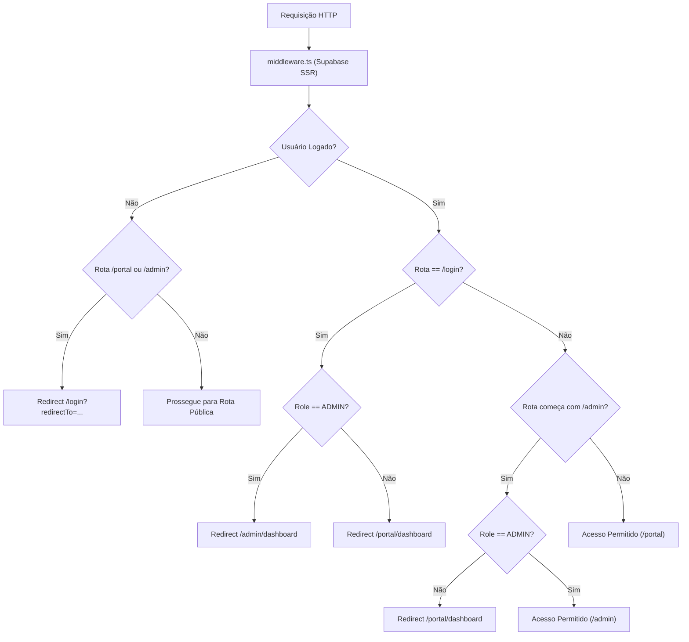
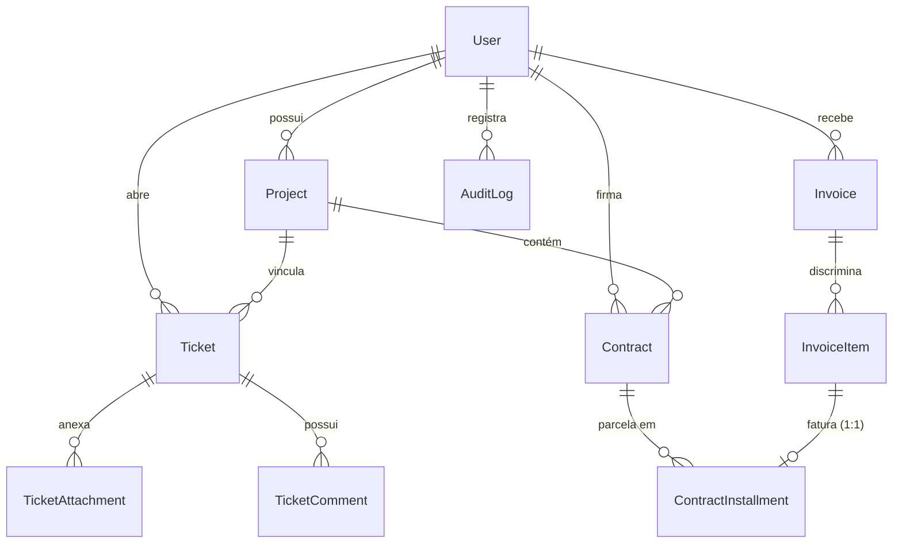
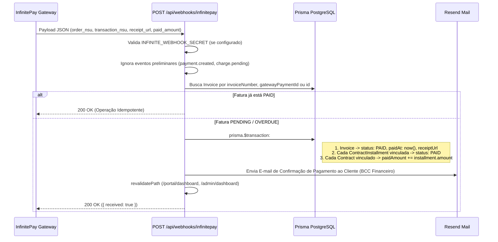
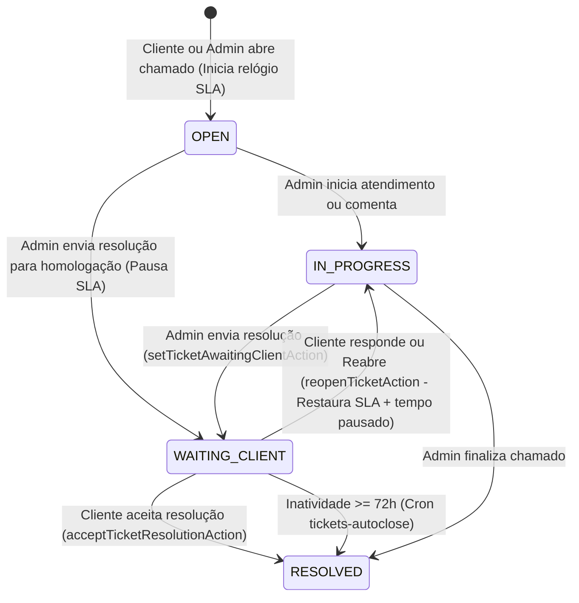

# 🏛️ Documentação Técnica Exaustiva — Área Logada MindSite SaaS

> **Documento de Arquitetura Oficial (`v2026.10`)**  
> **Escopo:** Área do Cliente (`/portal/*`), Painel Executivo do Dono (`/admin/*`), Motor Financeiro (InfinitePay + Régua Automatizada), Sistema de Chamados & SLA, Banco de Dados (Prisma + Supabase Supavisor), Storage Privado, E-mails Transacionais (Resend) e UI/UX.

---

## Sumário

1. [Visão Geral da Arquitetura & Stack Tecnológica](#1-visão-geral-da-arquitetura--stack-tecnológica)
2. [Autenticação, Sessão, RBAC & Segurança (Middleware)](#2-autenticação-sessão-rbac--segurança-middleware)
3. [Modelagem Completa do Banco de Dados (Prisma & PostgreSQL)](#3-modelagem-completa-do-banco-de-dados-prisma--postgresql)
4. [Infraestrutura de Conexão & Performance (Supavisor Pooler)](#4-infraestrutura-de-conexão--performance-supavisor-pooler)
5. [Engenharia Temporal, Fuso Horário Oficial de Brasília & Vencimentos (Regra D+1)](#5-engenharia-temporal-fuso-horário-oficial-de-brasília--vencimentos-regra-d1)
6. [Motor Financeiro: Contratos, Parcelas, Faturas & InfinitePay](#6-motor-financeiro-contratos-parcelas-faturas--infinitepay)
7. [Webhooks & Crons Automatizados (Vercel Cron)](#7-webhooks--crons-automatizados-vercel-cron)
8. [Mecânica de E-mails Transacionais (Resend & Templates HTML)](#8-mecânica-de-e-mails-transacionais-resend--templates-html)
9. [Sistema de Chamados Técnicos, Filas & Motor de SLA](#9-sistema-de-chamados-técnicos-filas--motor-de-sla)
10. [Armazenamento Seguro (Supabase Storage & Signed URLs)](#10-armazenamento-seguro-supabase-storage--signed-urls)
11. [Catálogo Completo de Server Actions (`app/actions/*`)](#11-catálogo-completo-de-server-actions-appactions)
12. [Arquitetura de UI/UX — Portal do Cliente (`/portal/*`)](#12-arquitetura-de-uiux--portal-do-cliente-portal)
13. [Arquitetura de UI/UX — Painel Administrativo (`/admin/*`)](#13-arquitetura-de-uiux--painel-administrativo-admin)
14. [Integrações Externas (Autentique GraphQL) & Auditoria LGPD](#14-integrações-externas-autentique-graphql--auditoria-lgpd)

---

## 1. Visão Geral da Arquitetura & Stack Tecnológica

A área logada da **MindSite** é uma plataforma SaaS B2B integrada ao ecossistema institucional da agência, desenhada para operar duas frentes isoladas por papéis (`UserRole`):
1. **Portal do Cliente (`/portal/dashboard` e `/portal/perfil`)**: Central de autoatendimento onde o cliente acompanha projetos ativos, assina contratos via Autentique, abre/homologa chamados técnicos com controle de SLA em tempo real e liquida faturas ou parcelas agendadas com autonomia via InfinitePay (Pix ou Cartão).
2. **Painel Executivo do Administrador (`/admin/dashboard`, `/admin/clients`, `/admin/clients/new`, `/admin/clients/[id]/edit`)**: ERP operacional e financeiro da MindSite para controle de MRR (Receita Recorrente Mensal), curvas de Receita Realizada vs. Projetada (12 meses), lançamento e baixa de despesas da empresa (BRL/USD com PTAX e comprovante), gestão de clientes/projetos/contratos e triagem completa de chamados técnicos.

### Stack Homologada
| Camada | Tecnologia | Papel Arquitetural |
| :--- | :--- | :--- |
| **Framework Web** | Next.js 16 (App Router / Turbopack) + React 19 | Renderização híbrida (RSC + Client Components), Server Actions (`"use server"`) e Streaming UI (`loading.tsx`). |
| **Linguagem** | TypeScript 5 (`strict`) | Tipagem ponta a ponta entre Prisma, Server Actions e Props de UI. |
| **Banco de Dados** | Supabase PostgreSQL + Prisma ORM 6.4.1 | Persistência relacional transacional com Connection Pooling via Supavisor (Porta `6543`) e Direct Connection (`5432`). |
| **Autenticação** | Supabase Auth (`@supabase/ssr`) | Gestão de sessão baseada em cookies HTTP-only, metadados de `role` (`ADMIN` / `CLIENT`) e flag `first_login`. |
| **Storage de Arquivos** | Supabase Storage (Buckets Privados) | Armazenamento privado de anexos de chamados (`ticket-attachments`) e comprovantes (`expense-receipts`) via Signed URLs de 3600s. |
| **Gateway de Pagamento** | InfinitePay API + Webhook | Emissão dinâmica de links de checkout (Pix/Cartão) e liquidação automática idempotente via Webhook. |
| **Mensageria de E-mail** | Resend SDK | Disparo de 8 templates HTML responsivos (Temas Claro para Clientes e Dark para Diretoria/Suporte). |
| **Assinatura Digital** | Autentique API v2 (GraphQL) | Consulta em tempo real de status de assinatura e links de download de contratos jurídicos. |

---

## 2. Autenticação, Sessão, RBAC & Segurança (Middleware)

### 2.1 Fluxo de Login e Sincronização (`app/actions/auth.ts`)
- **Action `signInWithEmail(formData)`**:
  1. Autentica credenciais no Supabase Auth via `supabase.auth.signInWithPassword({ email, password })`.
  2. Extrai o papel do usuário de `user.app_metadata?.role` (default: `CLIENT`).
  3. Executa `prisma.user.upsert` garantindo que o registro na tabela relacional `users` exista e esteja sincronizado com o UUID do Supabase Auth.
  4. Redireciona automaticamente:
     - `ADMIN` $\rightarrow$ `/admin/dashboard`
     - `CLIENT` $\rightarrow$ `/portal/dashboard` (ou rota informada em `redirectTo`).
- **Action `signOut()`**: Encerra a sessão no Supabase Auth e redireciona para `/login`.

### 2.2 Proteção de Rotas no Edge (`middleware.ts`)
O middleware intercepta todas as requisições dinâmicas e aplica 3 regras de segurança:
1. **Bloqueio de Não Autenticados**: Qualquer tentativa de acesso a `/portal/*` ou `/admin/*` sem sessão válida redireciona para `/login?redirectTo=<pathname>`.
2. **Isolamento Estrito da Área Administrativa**: Se um usuário autenticado tentar acessar `/admin/*` e seu `app_metadata.role` (ou `user_metadata.role`) não for `"ADMIN"`, ele é imediatamente redirecionado para `/portal/dashboard`.
3. **Bypass de Login para Usuários Autenticados**: Acessar `/login` já autenticado redireciona automaticamente para `/admin/dashboard` (se `ADMIN`) ou `/portal/dashboard` (se `CLIENT`).

### 2.3 Política de Primeiro Acesso (`FirstLoginPasswordModal.tsx`)
Quando o administrador cadastra um novo cliente via `createClientWithProjectsAction`, o usuário é criado no Supabase Auth com `user_metadata: { first_login: true }` e uma senha temporária (enviada no e-mail de boas-vindas).
- Ao abrir `/portal/dashboard`, se `isFirstLogin === true`, o modal `FirstLoginPasswordModal` é exibido em tela cheia (`zIndex: 99999`).
- O cliente pode escolher entre:
  - **"Trocar para uma Nova Senha Agora (Recomendado)"**: Exibe formulário com validação em tempo real de **5 requisitos de segurança**:
    1. Mínimo de 8 caracteres (`password.length >= 8`).
    2. Pelo menos 1 caractere especial (`/[!@#$%^&*()_+\-=[\]{};':"\\|,.<>/?]/`).
    3. Pelo menos 1 dígito numérico (`/[0-9]/`).
    4. Pelo menos 1 letra maiúscula (`/[A-Z]/`).
    5. **Proibição de sequências contínuas** de 3+ caracteres numéricos ou alfabéticos ascendentes ou descendentes (ex.: `123`, `321`, `abc`, `cba`), validada por `hasContinuousSequence(value)`.
    - **Regra de UX do Botão "Olho" (`👁`)**: Ao clicar no ícone de visualizar a senha digitada, o componente sincroniza automaticamente o campo *"Confirmar Nova Senha"* com o valor digitado.
    - Ao salvar, atualiza a senha no Supabase Auth, chama `completeFirstLoginAction({ passwordChanged: true })` (que limpa `first_login: false` via Admin API e grava log `PASSWORD_CHANGE` na tabela `audit_logs`).
  - **"Manter a Senha Atual e Ir para o Painel"**: Chama `completeFirstLoginAction({ passwordChanged: false })`, desativando o flag `first_login` para não exibir o modal novamente.

---

## 3. Modelagem Completa do Banco de Dados (Prisma & PostgreSQL)

O schema (`prisma/schema.prisma`) é composto por **10 tabelas relacionais** e **10 Enums**:

### 3.1 Diagrama Entidade-Relacionamento (ERD)

### 3.2 Dicionário de Enums
- **`UserRole`**: `ADMIN` | `CLIENT`
- **`TicketCategory`**:
  - `BASIC`: Troca de texto, imagem, criação de e-mail corporativo (**SLA: 24h**).
  - `INTERMEDIATE`: Ajustes de layout, cores, ordem de seções, carrossel (**SLA: 72h**).
  - `ADVANCED`: Novas rotas, refatoração de blocos, integrações (**SLA: 168h / 7 dias**).
- **`TicketStatus`**: `OPEN` | `IN_PROGRESS` | `WAITING_CLIENT` | `RESOLVED` | `CANCELLED`
- **`ContractType`**:
  - `SUSTAINABILITY`: Planos mensais recorrentes (Essential R\$ 100, Development R\$ 300, Advanced R\$ 700, Custom).
  - `PROJECT_DEV`: Setup / Implantação parcelada.
  - `HYBRID`: Contrato consolidado.
- **`ContractStatus`**: `ACTIVE` | `COMPLETED` | `SUSPENDED` | `CANCELLED`
- **`InstallmentStatus`**:
  - `SCHEDULED`: Parcela futura acordada no cronograma (ainda sem fatura gerada).
  - `BILLED`: Parcela já vinculada a um `InvoiceItem` de uma fatura emitida.
  - `PAID`: Parcela liquidada.
  - `CANCELLED`: Parcela cancelada.
- **`InvoiceStatus`**: `DRAFT` | `PENDING` | `PAID` | `OVERDUE` | `CANCELLED`
- **`PaymentMethod`**: `PIX` | `BOLETO` | `CREDIT_CARD` | `MANUAL_TRANSFER`
- **`ExpenseCategory`**: `INFRASTRUCTURE` | `SAAS_TOOLS` | `MARKETING_ADS` | `LEGAL_TAXES` | `OPERATIONAL` | `OTHER`
- **`ExpenseFrequency`**: `RECURRENT_MONTHLY` | `RECURRENT_ANNUAL` | `SPORADIC`
- **`Currency`**: `BRL` | `USD`

### 3.3 Tabelas do Banco de Dados
1. **`users` (`User`)**:
   - `id` (UUID, PK sincronizada com `auth.users`), `email` (Unique), `secondaryEmail`, `fullName`, `companyName`, `phone`, `document` (CPF/CNPJ), `address`, `avatarUrl`, `autentiqueDocId`, `role` (`UserRole`), `createdAt`, `updatedAt`.
2. **`projects` (`Project`)**:
   - `id` (UUID), `name`, `slug` (Unique), `domain`, `stagingUrl`, `description`, `isActive` (Boolean), `userId` (FK `users` Cascade).
3. **`tickets` (`Ticket`)**:
   - `id` (UUID), `ticketNumber` (Int Autoincrement — ex.: `#104`), `title`, `description` (Text), `category` (`TicketCategory`), `status` (`TicketStatus`), `slaHours` (24, 72 ou 168), `slaDueAt` (DateTime), `resolvedAt`, `slaPausedAt`, `slaTotalPausedSeconds` (Int default 0), `reopenReason` (Text), `userId`, `projectId`.
4. **`ticket_attachments` (`TicketAttachment`)**:
   - `id` (UUID), `fileName`, `fileUrl` (caminho relativo no bucket privado `ticket-attachments`), `fileSize`, `mimeType`, `ticketId`.
5. **`ticket_comments` (`TicketComment`)**:
   - `id` (UUID), `message` (Text), `authorName`, `isAdmin` (Boolean), `attachments` (`String[]` com caminhos no bucket), `ticketId`, `createdAt`.
6. **`contracts` (`Contract`)**:
   - `id` (UUID), `contractNumber`, `title`, `contractType` (`ContractType`), `status` (`ContractStatus`), `totalAmount` (`Decimal(12,2)`), `paidAmount` (`Decimal(12,2)`), `startDate`, `endDate`, `autentiqueDocId`, `notes`, `userId`, `projectId`.
7. **`contract_installments` (`ContractInstallment`)**:
   - `id` (UUID), `installmentNumber` (Int), `amount` (`Decimal(12,2)`), `scheduledDate` (DateTime), `status` (`InstallmentStatus`), `description`, `contractId`, `invoiceItemId` (Unique FK opcional para `invoice_items`).
8. **`invoices` (`Invoice`)**:
   - `id` (UUID), `invoiceNumber` (Unique — enviado como `order_nsu` para a InfinitePay), `dueDate`, `totalAmount` (`Decimal(12,2)`), `status` (`InvoiceStatus`), `paymentMethod`, `gatewayPaymentId` (Unique), `gatewayInvoiceUrl`, `receiptUrl`, `pixQrCode`, `pixCopyPaste`, `paidAt`.
   - **Flags e Timestamps da Régua de Cobrança**: `reminder5DaysSent`, `dueDaySent`, `overdue1DaySent`, `critical2DaysSent`, `reminderSentAt`, `dueTodaySentAt`, `overdueSentAt`, `criticalOverdueSentAt`, `adminAlertSentAt`.
9. **`invoice_items` (`InvoiceItem`)**:
   - `id` (UUID), `description`, `amount` (`Decimal(12,2)`), `invoiceId`. Possui relação 1:1 inversa com `ContractInstallment`.
10. **`company_expenses` (`CompanyExpense`)**:
    - `id` (UUID), `name`, `category` (`ExpenseCategory`), `frequency` (`ExpenseFrequency`), `currency` (`BRL`/`USD`), `estimatedAmount`, `actualAmountPaid`, `exchangeRateUsed` (`Decimal(8,4)` para PTAX do Dólar), `dueDate`, `paymentDate`, `isPaid`, `receiptUrl` (caminho no bucket `expense-receipts`), `notes`.
11. **`audit_logs` (`AuditLog`)**:
    - `id` (UUID), `action` (`PROFILE_EDIT`, `PASSWORD_CHANGE`, etc.), `ipAddress`, `userAgent`, `details` (`Json`), `userId`, `createdAt`.

---

## 4. Infraestrutura de Conexão & Performance (Supavisor Pooler)

Para evitar o erro `P2024: Timed out fetching a new connection from the connection pool` no ambiente Serverless/Turbopack:
1. **Singleton Estrito (`lib/prisma.ts` e `src/lib/prisma.ts`)**:
   - Uma única instância de `PrismaClient` é anexada a `globalThis.prisma`, impedindo a abertura de múltiplos clientes em hot-reloads ou invocações concorrentes de Server Actions.
2. **Configuração de Pooler (`.env` / `.env.local`)**:
   - `DATABASE_URL`: Usa a porta `6543` (Supavisor Transaction Mode) com `?pgbouncer=true&connection_limit=10&pool_timeout=20`.
   - `DIRECT_URL`: Usa a porta `5432` (Session Mode direto) exclusivamente para migrações (`prisma migrate` / `db push`).
3. **Consultas Concorrentes Cirúrgicas (`Promise.all` + `select` estrito)**:
   - Tanto `getClientDashboardData()` quanto `getAdminDashboardData()` executam **exatamente 4 queries concorrentes** (1 por tabela principal), sem `include` abertos, utilizando `select` estrito e paginação (`take: 20` / `take: 50` / `take: 100`), com isolamento `.catch()` individual por promessa.
   - Em `getClientDashboardData()`, caso ocorra falha transitória na leitura do usuário, o sistema utiliza um objeto de fallback seguro em memória e **jamais** chama `prisma.user.create()`, prevenindo erros `P2002 (Unique constraint failed on id)`.

---

## 5. Engenharia Temporal, Fuso Horário Oficial de Brasília & Vencimentos (Regra D+1)

Todo o motor financeiro e visual da MindSite opera estritamente sob o **Horário Oficial de Brasília (`America/Sao_Paulo`)**, imune ao fuso horário do servidor (UTC na Vercel) ou do dispositivo do usuário.

### 5.1 Prevenção de UTC Drift no Cadastro (`parseLocalDate` em `lib/utils.ts`)
Quando uma data é escolhida em um `<input type="date">` (ex.: `"2026-10-29"`), converter diretamente via `new Date("2026-10-29")` gera `2026-10-29T00:00:00.000Z` (meia-noite UTC), que em Brasília (`UTC-3`) recua para `28/10/2026 às 21:00`.
- A função `parseLocalDate(dateString)` extrai `[year, month, day]` e instancia `new Date(Date.UTC(year, month - 1, day, 12, 0, 0))` (**meio-dia UTC**). Isso blinda a data contra qualquer fuso entre `-12h` e `+12h`, preservando o dia civil exato no PostgreSQL.

### 5.2 Comparação Canônica de Calendário e Regra Estrita de Atraso (D+1)
Localizadas em `lib/utils.ts` (e espelhadas em `src/lib/utils.ts`):
- **`getBrasiliaTodayMidnight()`**: Extrai a data civil de hoje em `America/Sao_Paulo` via `Intl.DateTimeFormat("en-CA", { timeZone: "America/Sao_Paulo" })` e retorna um objeto `Date` zerado em `00:00:00.000`.
- **`toBrasiliaDateMidnight(dateInput)`**: Converte qualquer `Date` ou string ISO para a meia-noite civil de Brasília correspondente.
- **`isDateDueToday(dueDateInput)`**: Retorna `true` se `dueMidnight.getTime() === todayMidnight.getTime()`.
- **`isDateStrictlyOverdue(dueDateInput)`**: Retorna `true` **exclusivamente** se `dueMidnight.getTime() < todayMidnight.getTime()`.

> **Regra de Ouro de Negócio (D+1):**  
> Uma fatura ou parcela que vence hoje (ex.: `28/10/2026`) **NUNCA** é considerada em atraso durante o próprio dia `28/10/2026`. Até às `23:59:59` (horário de Brasília) do dia do vencimento, seu status é **"VENCE HOJE"** (`PENDING` / `SCHEDULED`). Ela só passa a ser considerada **"EM ATRASO"** (`OVERDUE` / `VENCIDA`) a partir de `00:00:00` do dia seguinte (`D+1`).

---

## 6. Motor Financeiro: Contratos, Parcelas, Faturas & InfinitePay

### 6.1 Estrutura de Receita da MindSite
Cada projeto de um cliente pode possuir dois tipos de contratos ativos simultaneamente:
1. **Contrato de Setup & Implantação (`ContractType.PROJECT_DEV`)**:
   - Possui valor total acordado (`totalAmount`), saldo pago acumulado (`paidAmount`) e múltiplas parcelas (`ContractInstallment`) com datas programadas (`scheduledDate`).
   - Na criação do projeto (`createClientWithProjectsAction`), o backend valida matematicamente que a soma das parcelas seja igual ao `setupAmount` (tolerância de `0.01`).
2. **Contrato de Sustentação Mensal (`ContractType.SUSTAINABILITY`)**:
   - Gera o **MRR (Monthly Recurring Revenue)** da agência e define a franquia mensal de chamados e caixas de e-mail do cliente:
     - **Essential (`R$ 100/mês`)**: 5 caixas de e-mail, 5 chamados básicos/mês (SLA 24h).
     - **Development (`R$ 300/mês`)**: 15 caixas de e-mail, 12 chamados/mês (10 básicos + 2 intermediários, SLA 24h a 72h).
     - **Advanced (`R$ 700/mês`)**: 30+ caixas de e-mail, 30 chamados/mês (25 básicos + 5 intermediários + 1 landing page, SLA até 7 dias).
     - **Personalizado (`Custom`)**: Valor e franquia customizados em contrato.

### 6.2 Modos de Emissão de Fatura (`Invoice`)
As faturas podem ser emitidas de **3 formas**:

1. **Auto-Faturamento pelo Próprio Cliente (`clientSelfIssueInvoiceAction` em `app/actions/portal.ts`)**:
   - No Portal do Cliente (`/portal/dashboard` $\rightarrow$ aba **Faturas & Pix**), caso o administrador ainda não tenha emitido a fatura, o cliente visualiza todas as suas parcelas `SCHEDULED` e a mensalidade de sustentação do mês vigente (`unbilledSustainability`).
   - O cliente seleciona via checkboxes quais parcelas/mensalidades deseja pagar e clica no botão de ação: **"PAGAR AGORA (PIX / CARTÃO) →"**.
   - Durante a solicitação, o botão exibe o estado de carregamento **"Gerando checkout seguro..."** desabilitando múltiplos cliques.
   - **Herança Obrigatória de Vencimento**: A `Invoice` gerada herda obrigatoriamente a `scheduledDate` da parcela mais antiga selecionada (ou a data de hoje caso seja apenas sustentação avulsa).
   - O backend chama `createInfinitePayCheckoutLink()`, grava a `Invoice` + `InvoiceItem`s e atualiza todas as parcelas selecionadas para `status: "BILLED"` vinculadas a `invoiceItemId` dentro de uma transação `prisma.$transaction(..., { maxWait: 10000, timeout: 20000 })`.
   - **Redirecionamento Automático Imediato**: O client component redireciona instantaneamente o navegador para a URL oficial de checkout da InfinitePay via `window.location.href = res.checkoutUrl;`.
   - **Modal de Detalhamento da Fatura Ativa ("Visualizar Fatura")**: No card superior de destaque da fatura em aberto (`data.activeInvoice`), além do botão de pagamento InfinitePay, há um botão outline secundário **"Visualizar Fatura"**. Ao clicar, abre um modal acessível (com suporte a tecla `Esc` e clique no backdrop) exibindo o número da fatura, data de vencimento, tabela discriminada de itens e serviços com valores unitários, total consolidado e botão direto de liquidação.

2. **Emissão Imediata pelo Administrador (`issueImmediateInvoiceAction` em `app/actions/admin.ts`)**:
   - No Painel Admin (ou na tela de edição do cliente), o dono pode emitir uma fatura avulsa ou faturar parcelas específicas (`SCHEDULED`) com 1 clique.
   - Gera o link oficial na InfinitePay, persiste a `Invoice` com identificador `#INV-XXXXXX`, vincula as parcelas como `BILLED` e **dispara automaticamente o e-mail de Fatura Emitida** (`renderInvoiceEmailHtml`) via Resend.

3. **Baixa Manual de Parcela pelo Administrador (`settleInstallmentManuallyAction` em `app/actions/adminClients.ts`)**:
   - Caso o cliente pague por transferência direta ou Pix fora do checkout, o admin clica em **"Baixar"** na parcela.
   - Em uma transação atômica (`prisma.$transaction`), o sistema:
     1. Atualiza a `ContractInstallment` para `status: "PAID"`.
     2. Incrementa `paidAmount` no `Contract` correspondente.
     3. Se a parcela já estava vinculada a uma `Invoice` (`invoiceItemId`), marca a `Invoice` como `PAID` com `paidAt: new Date()`.

### 6.3 Integração InfinitePay (`lib/payment/infinitepay.ts`)
- **Endpoint**: `POST https://api.checkout.infinitepay.io/links`
- **Parâmetros Enviados**:
  - `handle`: `process.env.INFINITEPAY_HANDLE || "mindsite"`
  - `order_nsu`: `invoiceNumber` (ex.: `INV-482910`)
  - `items`: Array com `description`, `price` (em centavos) e `quantity: 1`
  - `redirect_url`: `https://mindsite.com.br/portal/dashboard?payment=success`
  - `webhook_url`: `https://mindsite.com.br/api/webhooks/infinitepay`
  - `customer`: `{ name, email, phone_number }`

---

## 7. Webhooks & Crons Automatizados (Vercel Cron)

### 7.1 Webhook de Liquidação InfinitePay (`POST /api/webhooks/infinitepay`)
Arquivo: `app/api/webhooks/infinitepay/route.ts`

- **Segurança**: Verifica o header `x-webhook-secret`, `x-infinite-secret` ou `Authorization: Bearer <INFINITE_WEBHOOK_SECRET>`.
- **Compatibilidade Multi-Schema**: Extrai `orderNsu` de `body.order_nsu`, `body.data?.order_nsu`, `body.invoice_number`, `body.metadata?.invoiceNumber` ou `body.order_id`.
- **Idempotência**: Se `invoice.status === "PAID"`, retorna `200 OK` imediatamente sem duplicar soma no contrato nem reenviar e-mail.
- **Baixa Atômica em Cascata**: Liquida a `Invoice`, todas as `ContractInstallment` vinculadas aos `InvoiceItem`s e incrementa o `paidAmount` do `Contract`.
- **Recibo por E-mail**: Dispara confirmação imediata de pagamento para o cliente com cópia oculta (`bcc`) para `contato@mindsite.com.br` e `financeiro@mindsite.com.br`, incluindo botão para o comprovante oficial (`receipt_url`).

---

### 7.2 Cron 1: Régua Automatizada de Ciclo de Vida de Faturas (`GET /api/cron/invoices-lifecycle`)
- **Agendamento (`vercel.json`)**: `"0 11 * * *"` $\rightarrow$ Executa todos os dias às **11:00 UTC (08:00 BRT — Horário de Brasília)**.
- **Autenticação**: Header `Authorization: Bearer <CRON_SECRET>`.
- **Garantia de Link Ativo**: Antes de enviar qualquer lembrete, a função `ensureInvoiceCheckoutUrl(inv)` verifica se a fatura já possui `gatewayInvoiceUrl`; se não possuir, gera o link na InfinitePay e atualiza a fatura.
- **Destinatários**: Envia sempre para `user.email` e, se cadastrado, também para `user.secondaryEmail`.

#### As 5 Etapas da Régua de Cobrança:
| Etapa | Condição de Disparo (Brasília) | Flag de Controle | Ações Executadas pelo Cron |
| :--- | :--- | :--- | :--- |
| **0. `ABANDONED_3H` (3h - 24h)** | `status == PENDING`, `createdAt <= now - 3h` e `>= now - 24h`, `reminderSentAt == null` | `reminderSentAt` | Envia e-mail **Fatura Disponível para Pagamento** com Pix Copia e Cola e link direto InfinitePay. |
| **1. `UPCOMING_5D` (D-5)** | `status == PENDING`, `dueDate == Hoje + 5 dias`, `reminderSentAt == null` | `reminderSentAt` / `reminder5DaysSent` | Envia e-mail claro **Lembrete de Vencimento (5 dias)** (`UPCOMING_5D`). |
| **2. `DUE_TODAY` (D0)** | `status == PENDING`, `dueDate == Hoje`, `dueTodaySentAt == null` | `dueTodaySentAt` / `dueDaySent` | Envia e-mail claro **Sua Fatura Vence Hoje** (`DUE_TODAY` — badge âmbar). |
| **3. `OVERDUE_1D` (D+1)** | `status IN [PENDING, OVERDUE]`, `dueDate == Ontem (Hoje - 1)`, `overdueSentAt == null` | `overdueSentAt` / `overdue1DaySent` / `adminAlertSentAt` | 1. Atualiza `Invoice.status = "OVERDUE"`. 2. Envia e-mail claro **Aviso de Fatura Vencida** ao cliente. 3. Dispara **Alerta Dark de Inadimplência para a Diretoria** (`contato@mindsite.com.br`) com botão direto de cobrança via WhatsApp (`wa.me`). |
| **4. `OVERDUE_3D` (D+3)** | `status IN [OVERDUE, PENDING]`, `dueDate <= Hoje - 3 dias`, `criticalOverdueSentAt == null` | `criticalOverdueSentAt` / `critical2DaysSent` | Atualiza `status = "OVERDUE"` e envia e-mail crítico **URGENTE: Risco de Suspensão de Serviços** (`OVERDUE_3D`). |

---

### 7.3 Cron 2: Auto-Fechamento de Chamados em 72h (`GET /api/cron/tickets-autoclose`)
- **Agendamento (`vercel.json`)**: `"0 * * * *"` $\rightarrow$ Executa **a cada hora** (minuto 0).
- **Autenticação**: Header `Authorization: Bearer <CRON_SECRET>`.
- **Regra de Negócio**:
  - Busca todos os chamados com `status === "WAITING_CLIENT"` cujo `slaPausedAt` (ou `updatedAt`) seja anterior ou igual a **72 horas atrás** (`now - 72h`).
  - Para cada chamado elegível, executa `prisma.$transaction`:
    1. Atualiza o chamado para `status: "RESOLVED"`, `resolvedAt: now`, `slaPausedAt: null`.
    2. Insere um comentário oficial na timeline com autor `"Sistema MindSite (SLA Bot)"`:
       > *"Chamado encerrado automaticamente por inatividade após 72 horas em conformidade com as regras de SLA."*

---

## 8. Mecânica de E-mails Transacionais (Resend & Templates HTML)

Todos os templates residem em `lib/mail/` e `src/lib/mail/` e seguem duas diretrizes visuais padronizadas:
- **Logotipo Oficial Único**: `https://mindsite.com.br/img/logo-email.png` renderizado em `72x72px` (`width="72" height="72"`).
- **Cabeçalho Mobile Responsivo (`@media only screen and (max-width: 480px)`)**: As células `.header-logo-cell` e `.header-badge-cell` da tabela `.header-table` empilham verticalmente com `display: block !important; width: 100% !important; text-align: center !important;`, eliminando quebras ou texto espremido no Gmail Mobile/iOS Mail. Sem colchetes literais `[` `]` nos badges.

### Catálogo dos 8 Templates Transacionais

| Arquivo | Tema Visual | Remetente | Gatilho de Disparo | Conteúdo Principal |
| :--- | :--- | :--- | :--- | :--- |
| **`welcomeTemplate.ts`** | Dark (`#0a0a0c`) | `MindSite <contato@mindsite.com.br>` | Cadastro de novo cliente (`createClientWithProjectsAction`) | Credenciais de acesso (URL do Portal, E-mail de login, Senha Provisória), nome do projeto e benefícios do plano de sustentação. |
| **`newProjectTemplate.ts`** | Claro (`#ffffff`) | `MindSite <no-reply@mindsite.com.br>` | Adição de novo projeto a cliente existente (`addProjectToClientAction`) | Escopo do projeto, domínio, tabela completa de parcelas de setup (vencimento + valor) e resumo do plano de sustentação. |
| **`invoiceTemplate.ts`** | Claro (`#ffffff`) | `MindSite Financeiro <financeiro@mindsite.com.br>` | Emissão imediata de fatura pelo Admin (`issueImmediateInvoiceAction`) | Tabela discriminada de `InvoiceItem`s, valor total consolidado, box de vencimento, botão CTA para checkout InfinitePay e código Pix Copia e Cola. |
| **`invoiceReminderTemplate.ts`** | Claro (`#ffffff`) | `MindSite Financeiro <financeiro@mindsite.com.br>` | Cron diário (`/api/cron/invoices-lifecycle`) nos estágios `UPCOMING_5D`, `DUE_TODAY`, `OVERDUE_1D` e `OVERDUE_3D` | Badge dinâmico por estágio (Azul $\rightarrow$ Âmbar $\rightarrow$ Vermelho $\rightarrow$ Vinho Crítico), itens da fatura, botão de pagamento InfinitePay e atalho direto para o Financeiro via WhatsApp. |
| **`adminInvoiceOverdueTemplate.ts`** | Dark (`#111114`) | `MindSite Financeiro <financeiro@mindsite.com.br>` | Cron diário (`OVERDUE_1D`) enviado para `contato@mindsite.com.br` | Alerta interno de inadimplência com Razão Social, CPF/CNPJ, Projeto, Fatura `#INV`, valor vencido e botão verde **"💬 COBRAR DIRETAMENTE VIA WHATSAPP →"** pré-preenchido com mensagem para o cliente. |
| **`ticketCreatedTemplate.ts`** | Claro (`#ffffff`) | `MindSite Suporte <suporte@mindsite.com.br>` | Abertura de chamado pelo Admin em nome do cliente (`createTicketForClientAction`) | Número do chamado (`#ticketNumber`), complexidade (`BASIC`/`INTERMEDIATE`/`ADVANCED`), prazo estimado de SLA e descrição completa. |
| **`ticketNotificationTemplate.ts`** | Dark (`#111114`) | `MindSite <no-reply@mindsite.com.br>` | Resposta técnica do Admin (`NOVA_MENSAGEM`) ou conclusão para validação (`AGUARDANDO_CLIENTE`) | Snippet da mensagem ou instruções de resolução, alerta de **Prazo de Validação de 72 horas** (quando `AGUARDANDO_CLIENTE`) e anexos físicos em buffer (`attachments`) enviados junto ao e-mail. |
| **`leadTemplate.ts`** | Dark (`#0b0b0e`) | `MindSite <no-reply@mindsite.com.br>` | Formulário de contato institucional (`contact.ts`) | Notificação de novo lead comercial com dados do prospect, empresa, orçamento e mensagem. |

---

## 9. Sistema de Chamados Técnicos, Filas & Motor de SLA

### 9.1 Categorias e Prazos Contratuais de SLA
Ao criar um chamado (`createTicketAction` pelo cliente ou `createTicketForClientAction` pelo admin), o prazo máximo de entrega (`slaDueAt`) é calculado a partir da categoria:
- **`BASIC`**: `24 horas` (`slaHours = 24`)
- **`INTERMEDIATE`**: `72 horas` (`slaHours = 72`)
- **`ADVANCED`**: `168 horas / 7 dias` (`slaHours = 168`)

Caso o administrador reclassifique a complexidade do chamado na triagem (`reclassifyTicketAction`), o sistema atualiza `category`, `slaHours` e **recalcula `slaDueAt` a partir do `createdAt` original do chamado**.

### 9.2 Ciclo de Vida e Máquina de Estados do Chamado (`TicketStatus`)

### 9.3 Mecânica Matemática de Pausa e Retomada do SLA
1. **Quando o Admin marca como `WAITING_CLIENT` (`setTicketAwaitingClientAction`)**:
   - O campo `slaPausedAt` recebe `new Date()`.
   - O badge visual no portal do cliente muda imediatamente para **`⏸️ SLA Pausado`**, congelando o cronômetro regressivo enquanto a bola está com o cliente para homologação.
   - O cliente recebe um e-mail com os arquivos de evidência anexados e o aviso de 72h para validação.
2. **Quando o Cliente Reabre (`reopenTicketAction`) ou Responde (`addTicketReplyAction`) um chamado em `WAITING_CLIENT`**:
   - O sistema calcula exatamente quantos segundos o chamado permaneceu pausado:
     $$\text{pausedSeconds} = \left\lfloor \frac{\text{now} - \text{slaPausedAt}}{1000} \right\rfloor$$
   - Desloca o vencimento do SLA para frente pelo exato período em que ficou aguardando o cliente:
     $$\text{newSlaDueAt} = \text{slaDueAt} + (\text{pausedSeconds} \times 1000)$$
   - Acumula `slaTotalPausedSeconds += pausedSeconds`, limpa `slaPausedAt = null` e retorna o status para `IN_PROGRESS`.
3. **Validação Zod na Reabertura (`app/actions/tickets.schema.ts`)**:
   - Para reabrir um chamado (`reopenTicketAction`), o cliente é obrigado a informar uma justificativa com pelo menos 10 caracteres (`reopenTicketSchema`), que fica gravada em `Ticket.reopenReason` e como comentário destacado na timeline.

### 9.4 Isolamento de Filas na UI (Ativos vs. Histórico Concluído)
Tanto no Portal do Cliente (`PortalDashboardView.tsx`) quanto no Painel Admin (`AdminDashboardView.tsx`), a listagem de chamados é estritamente dividida em duas filas independentes:
- **Fila Principal ("Chamados em Atendimento" / "Fila Ativa")**: Exibe exclusivamente chamados com `status !== "RESOLVED" && status !== "CANCELLED"`.
- **Seção "Histórico de Chamados Concluídos"**: Exibe exclusivamente chamados `RESOLVED` ou `CANCELLED`, mantendo a fila operacional limpa.

---

## 10. Armazenamento Seguro (Supabase Storage & Signed URLs)

Nenhum arquivo sensível de chamado ou comprovante financeiro utiliza URLs públicas estáticas. Toda a arquitetura opera com **Buckets Privados** e **Upload Postergado (Deferred Upload)**:

### 10.1 Buckets Privados Configurados
1. **`ticket-attachments`** (`public: false`):
   - Caminhos de armazenamento:
     - Abertura pelo cliente: `{userId}/{timestamp}-{random}.{ext}`
     - Abertura pelo admin: `tickets/{ticketId}/admin_{timestamp}_{filename}`
     - Respostas na timeline: `tickets/{ticketId}/replies/{timestamp}_{random}_{filename}`
     - Evidências de resolução: `tickets/{ticketId}/resolution/{timestamp}_{random}_{filename}`
     - Anexos de reabertura: `tickets/{ticketId}/reopen/{timestamp}_{random}_{filename}`
2. **`expense-receipts`** (`public: false`, limite 25MB):
   - Caminhos de armazenamento: `expenses/{expenseId}/{timestamp}_{filename}`

### 10.2 Upload Postergado (Deferred Upload)
- Nos modais de abertura de chamado (Cliente e Admin), resposta de chamado e baixa/edição de despesas, selecionar um arquivo no `<input type="file">` armazena o objeto `File` **apenas no estado local do React (`useState<File[]>`)**.
- O upload para o Supabase Storage só é executado no momento exato em que o usuário clica no botão final de submit (**"Registrar Chamado"**, **"Enviar Resposta"**, **"Confirmar Baixa"**), evitando arquivos órfãos no bucket caso o modal seja fechado.

### 10.3 Geração de Signed URLs Temporárias (60 minutos)
- **Anexos de Chamados (`getAttachmentSignedUrlAction`)**:
  - Verifica se o usuário está autenticado e se é `ADMIN` ou dono do chamado (`ticket.userId === user.id`).
  - Normaliza caminhos legados e gera uma URL assinada via `supabaseAdmin.storage.from("ticket-attachments").createSignedUrl(filePath, 3600)` válida por **3600 segundos (1 hora)**.
- **Comprovantes de Despesas (`getExpenseReceiptSignedUrlAction`)**:
  - Restrita a administradores (`assertAdminUser()`).
  - Gera URL assinada temporária de 3600s no bucket `expense-receipts`.

---

## 11. Catálogo Completo de Server Actions (`app/actions/*`)

Todas as Server Actions respeitam a regra do Next.js 16 de **não exportar objetos literais ou funções síncronas** de arquivos `"use server"` (schemas Zod e tipos ficam isolados em arquivos `.schema.ts` e `.types.ts`).

### 11.1 `app/actions/auth.ts`
| Action | Assinatura / Entrada | Retorno / Comportamento |
| :--- | :--- | :--- |
| `signInWithEmail` | `FormData (email, password, redirectTo)` | Autentica no Supabase, faz `upsert` em ` public.users` e redireciona por `role`. |
| `signOut` | `void` | Faz logout no Supabase Auth e redireciona para `/login`. |

### 11.2 `app/actions/portal.ts` (Área do Cliente)
| Action | Assinatura / Entrada | Retorno / Comportamento |
| :--- | :--- | :--- |
| `getClientDashboardData` | `void` | Executa 4 queries em `Promise.all` (`user`, `project`, `ticket`, `invoice`), consulta Autentique se houver `docId`, calcula SLAs, franquia do plano e atrasos estritos (`isDateStrictlyOverdue`). |
| `createTicketAction` | `{ title, description, category, projectId?, attachments? }` | Cria chamado com `slaHours` (24/72/168) e registra `TicketAttachment`s. |
| `uploadTicketAttachmentAction` | `FormData (file)` | Faz upload de arquivo para o bucket privado `ticket-attachments` sob `{userId}/{fileName}`. |
| `getAttachmentSignedUrlAction` | `attachmentIdOrUrl: string` | Valida permissão do usuário e retorna Signed URL de 3600s. |
| `clientSelfIssueInvoiceAction` | `{ selectedInstallmentIds, includeSustainability?, includeCurrentInvoice?, paymentMethod? }` | Gera link de checkout na InfinitePay, cria `Invoice` + `InvoiceItem`s e marca parcelas como `BILLED` em transação atômica. |
| `generateConsolidatedPaymentAction` | Alias para `clientSelfIssueInvoiceAction` | Compatibilidade de consolidação de pagamento pelo cliente. |
| `updateClientProfileAction` | `{ fullName?, phone?, address?, secondaryEmail?, avatarUrl? }` | Atualiza perfil do cliente e grava log `PROFILE_EDIT` em `audit_logs`. |
| `completeFirstLoginAction` | `{ passwordChanged?: boolean }` | Define `user_metadata.first_login = false` no Supabase Auth e grava `PASSWORD_CHANGE` se aplicável. |
| `logPasswordChangeAuditAction` | `void` | Registra evento `PASSWORD_CHANGE` (`reason: "PROFILE_CHANGE"`) na tabela `audit_logs`. |
| `getClientProfileData` | `void` | Retorna dados cadastrais do cliente logado para `/portal/perfil`. |

### 11.3 `app/actions/tickets.ts` (Interações e Homologação de Chamados)
| Action | Assinatura / Entrada | Retorno / Comportamento |
| :--- | :--- | :--- |
| `addTicketReplyAction` | `FormData (ticketId, message, files[])` | Faz upload de múltiplos anexos em `tickets/{id}/replies/`, cria `TicketComment`, retoma SLA se cliente respondeu em `WAITING_CLIENT` e envia e-mail se respondido pelo Admin. |
| `setTicketAwaitingClientAction` | `FormData (ticketId, message, files[])` | Exclusivo Admin. Faz upload de evidências em `tickets/{id}/resolution/`, pausa o SLA (`status: "WAITING_CLIENT"`, `slaPausedAt: now`) e envia e-mail com anexos ao cliente. |
| `acceptTicketResolutionAction` | `ticketId` ou `{ ticketId, feedback? }` | Exclusivo Cliente/Admin. Encerra o chamado (`status: "RESOLVED"`, `resolvedAt: now`) e grava comentário de homologação. |
| `reopenTicketAction` | `FormData (ticketId, reason, files[])` | Valida motivo via Zod (`min 10 chars`), soma tempo pausado ao `slaDueAt`, volta status para `IN_PROGRESS` e anexa arquivos de reabertura. |

### 11.4 `app/actions/admin.ts` (Painel Executivo do Dono)
| Action | Assinatura / Entrada | Retorno / Comportamento |
| :--- | :--- | :--- |
| `getAdminDashboardData` | `void` | Executa 4 queries concorrentes, calcula MRR, distribuição de planos, projeção de 12 meses, comparativo de despesas, receita realizada (`calculateRevenueAnalytics`), saldos de clientes e fila de chamados. |
| `reclassifyTicketAction` | `(ticketId, newCategory)` | Altera categoria (`BASIC`/`INTERMEDIATE`/`ADVANCED`) e recalcula `slaHours` e `slaDueAt`. |
| `updateTicketStatusAction` | `(ticketId, newStatus)` | Atualiza status do chamado e dispara e-mail caso mude para `WAITING_CLIENT`. |
| `createTicketForClientAction` | `FormData (clientId, projectId, title, category, description, files[])` | Abre chamado em nome do cliente (triagem WhatsApp), faz upload postergado de múltiplos anexos e envia e-mail `ticketCreatedTemplate`. |
| `createExpenseAction` | `CreateExpenseInput` | Registra despesa operacional (`BRL` ou `USD` com `exchangeRateUsed`). |
| `settleExpenseAction` | `(expenseId, actualAmountPaid, ...)` | Dá baixa em despesa operacional registrando valor pago, PTAX e comprovante. |
| `createInvoiceWithItemsAction` | `CreateInvoiceInput` | Cria fatura consolidada manualmente e vincula parcelas como `BILLED`. |
| `issueImmediateInvoiceAction` | `{ userId, items, dueDateOption, ... }` | Gera link InfinitePay, cria fatura `#INV-XXXXXX`, vincula parcelas e envia `invoiceTemplate` por e-mail. |

### 11.5 `app/actions/adminClients.ts` (Gestão de Clientes, Projetos e Contratos)
| Action | Assinatura / Entrada | Retorno / Comportamento |
| :--- | :--- | :--- |
| `createClientWithProjectsAction` | `ClientDTO` | Valida soma das parcelas, cria usuário no Supabase Auth (`first_login: true`), persiste `User` + `Project`s + `Contract`s + `ContractInstallment`s em transação com rollback de Auth em caso de erro e envia `welcomeTemplate`. |
| `getClientsListAction` | `query?: string` | Lista carteira de clientes com busca textual por nome, empresa, e-mail, CPF/CNPJ, projeto ou número de fatura. |
| `getClientByIdAction` | `clientId: string` | Retorna árvore completa do cliente (projetos, contratos, parcelas e faturas) com `Decimal` serializado para `Number`. |
| `updateClientAction` | `(clientId, Partial<ClientDTO>)` | Atualiza dados cadastrais e propaga `autentiqueDocId` para os contratos do cliente. |
| `addProjectToClientAction` | `(clientId, ProjectInputDTO)` | Cria novo projeto + contrato de setup + parcelas + contrato de sustentação e dispara e-mail `newProjectTemplate`. |
| `updateProjectAction` | `(projectId, { name, domain, description })` | Edita nome, domínio oficial e escopo de um projeto existente. |
| `updateContractStatusAction` | `(contractId, status: ContractStatus)` | Pausa (`SUSPENDED`), reativa (`ACTIVE` com `endDate = null`) ou encerra (`CANCELLED`/`COMPLETED` com `endDate = new Date()`) contratos de sustentação. |
| `settleInstallmentManuallyAction` | `installmentId: string` | Baixa parcela manualmente (`PAID`), incrementa `Contract.paidAmount` e quita `Invoice` vinculada. |
| `addInstallmentToContractAction` | `(contractId, { amount, scheduledDate, description })` | Adiciona parcela extra ao contrato e incrementa `Contract.totalAmount`. |
| `resetClientPasswordAction` | `(userId, newPassword)` | Redefine senha do cliente diretamente via Supabase Admin API. |

### 11.6 `app/actions/expenses.ts` & `app/actions/finance.ts`
| Action | Arquivo | Retorno / Comportamento |
| :--- | :--- | :--- |
| `getExpenseReceiptSignedUrlAction` | `expenses.ts` | Gera Signed URL de 3600s para comprovante no bucket `expense-receipts`. |
| `attachExpenseReceiptAction` | `expenses.ts` | Faz upload e vincula comprovante a uma despesa existente. |
| `updateExpenseAction` | `expenses.ts` | Edição completa de despesa operacional (`parseLocalDate`, moeda, PTAX, status pago). |
| `calculateRevenueAnalytics` | `finance.ts` | Agrega a **Receita Realizada vs. Projetada** dos últimos 12 meses no fuso `America/Sao_Paulo` sem duplicar conexões quando recebe dados pré-carregados (`prefetched`). |

---

## 12. Arquitetura de UI/UX — Portal do Cliente (`/portal/*`)

### 12.1 Streaming UI & Skeletons (`app/portal/loading.tsx`)
Durante o carregamento Server-Side de `app/portal/dashboard/page.tsx`, o Next.js exibe instantaneamente o skeleton estrutural no tema escuro da MindSite (`var(--base)`, `var(--base-tint)`), eliminando telas brancas ou bloqueio de navegação.

### 12.2 Estrutura do Painel (`/portal/dashboard` $\rightarrow$ `PortalDashboardView.tsx`)
1. **Cabeçalho Superior**:
   - Saudação personalizada com nome do cliente/empresa, badge do projeto ativo e domínio clicável.
   - Atalhos rápidos para **Meu Perfil & Segurança (`/portal/perfil`)**, **Novo Chamado (`+`)** e **Sair**.
2. **Banners Inteligentes de Status no Topo**:
   - **Banner de Inadimplência (Vermelho)**: Exibido *exclusivamente* quando `billingSummary.isOverdue === true` (ou seja, existe fatura ou parcela cujo vencimento é estritamente anterior a hoje em Brasília — Regra D+1).
   - **Banner de Homologação Pendente (Âmbar)**: Exibido quando há chamados em `WAITING_CLIENT`, com botão que leva diretamente ao chamado aguardando aceite.
3. **Cards de Resumo Executivo (KPIs)**:
   - **Plano de Sustentação Ativo**: Nome do plano, valor mensal, franquia de caixas de e-mail e barra de progresso de consumo de chamados no mês (`ticketsConsumedThisMonth / monthlyQuota`).
   - **Chamados em Atendimento**: Contagem de chamados ativos (`OPEN` + `IN_PROGRESS`), aguardando validação (`WAITING_CLIENT`) e concluídos (`RESOLVED`).
   - **Situação Financeira**: Destaca se todas as obrigações até a data corrente estão quitadas (`EM DIA`) ou exibe o total pendente/vencido.
   - **Contrato Jurídico (Autentique)**: Exibe se o contrato está `ASSINADO` (verde, com link para download do PDF) ou `PENDENTE DE ASSINATURA` (âmbar, com link direto para assinatura no Autentique).
4. **Abas de Navegação do Cliente**:
   - **Aba 1: Chamados & Suporte Técnico**:
     - **Fila de Chamados em Atendimento**: Cards expansíveis com badge de categoria (`BASIC 24h`, `INTERMEDIATE 72h`, `ADVANCED 168h`), cronômetro regressivo em tempo real (`SLACountdownBadge` atualizado a cada 60s), anexos com botão de visualização segura (Signed URL) e timeline de mensagens.
     - **Botão de Toggle de Mensagens**: Estilizado com destaque azul (`rgba(0, 43, 186, 0.25)`, borda `#3b82f6`, texto `#93c5fd`) para expandir ou **"OCULTAR MENSAGENS ▲"**.
     - **Painel de Homologação (`WAITING_CLIENT`)**: Quando a MindSite conclui um chamado, o cliente vê dois botões de decisão:
       - **✓ Aceitar e Concluir Chamado**: Abre confirmação com feedback opcional e encerra o ticket (`RESOLVED`).
       - **↺ Solicitar Ajustes / Reabrir**: Abre modal exigindo justificativa mínima de 10 caracteres e anexos opcionais, retomando o SLA.
     - **Histórico de Chamados Concluídos**: Seção dedicada na parte inferior listando todos os chamados `RESOLVED` / `CANCELLED`.
   - **Aba 2: Faturas, Parcelas & Pix**:
     - **Fatura Emitida em Aberto (`activeInvoice`)**: Se houver fatura `PENDING` ou `OVERDUE`, exibe card de destaque com discriminação de itens, botão primário **"PAGAR NO CHECKOUT INFINITEPAY (PIX OU CARTÃO) →"**, QR Code e botão de copiar Código Pix Copia e Cola.
     - **Auto-Emissão de Parcelas Agendadas ("Próximos Pagamentos Agendados")**:
       - Lista a mensalidade de sustentação do mês vigente (se ainda não faturada) e todas as parcelas `SCHEDULED` do contrato de setup.
       - Cada linha exibe badge temporal preciso em Brasília: **`VENCE HOJE`** (âmbar), **`VENCIDA (NÃO FATURADA)`** (vermelho — apenas D+1) ou **`AGENDADA`** (azul/neutro).
       - Checkboxes interativos calculam a soma dinâmica em tempo real e permitem ao cliente clicar em **"GERAR FATURA E PAGAR AGORA →"** (`clientSelfIssueInvoiceAction`).
     - **Histórico de Faturas**: Tabela com faturas pagas e emitidas, data de liquidação e link direto para o comprovante oficial (`receiptUrl`).

### 12.3 Página "Meu Perfil & Segurança" (`/portal/perfil` $\rightarrow$ `PortalProfileView.tsx`)
- Permite atualizar Nome Completo, E-mail Secundário (que passa a receber cópia de todos os lembretes de fatura e notificações de novos projetos), Telefone/WhatsApp, Endereço e Avatar.
- Possui seção dedicada de **Alteração de Senha** com os mesmos 5 requisitos de segurança e registro automático de auditoria LGPD (`AuditLog`).

---

## 13. Arquitetura de UI/UX — Painel Administrativo (`/admin/*`)

### 13.1 Painel Executivo Principal (`/admin/dashboard` $\rightarrow$ `AdminDashboardView.tsx`)
Organizado em **5 Abas Operacionais**:
1. **VISÃO GERAL (`OVERVIEW`)**:
   - **KPIs de Topo**: MRR Ativo Total, Projeção de Recebimentos (30/60/90/120 dias), Faturas em Atraso (contagem e valor estrito D+1), Chamados em Aberto / SLA Estourado e Despesas do Mês (Estimado vs. Pago).
   - **Gráfico de Receita Realizada vs. Projetada (`RealizedRevenueChart.tsx`)**: Curva dos últimos 12 meses comparando o que foi efetivamente liquidado (`PAID`) com o faturamento previsto no fuso de São Paulo.
   - **Distribuição de Planos de Sustentação**: Contagem de assinantes Essential, Development, Advanced e Custom.
2. **FINANCEIRO & RECEBÍVEIS (`FINANCE`)**:
   - Projeção mês a mês para os próximos 12 meses (`MRR + Milestones de Setup`).
   - Tabela consolidada de **Saldos por Cliente (`clientBalances`)**: mostra Total de Setup, Valor Pago, Saldo a Receber, Plano de Sustentação, Status (`EM_DIA`, `ATRASO`, `QUITADO`), parcelas pendentes com badge `[ #INV-XXXXXX ]` e botões rápidos para **Emitir Fatura InfinitePay** ou **Baixar Parcela Manualmente**.
3. **CHAMADOS & SLA (`TICKETS`)**:
   - **Botão "+ Abrir Chamado p/ Cliente"**: Modal com Combobox de busca de cliente, seleção de projeto, categoria de SLA e **upload postergado de múltiplos anexos** (`createTicketForClientAction`).
   - **Fila Ativa de Triagem**: Permite reclassificar complexidade (`BASIC` / `INTERMEDIATE` / `ADVANCED`), alterar status (`OPEN` $\rightarrow$ `IN_PROGRESS`), responder na timeline anexando arquivos (`addTicketReplyAction`) ou **Enviar para Validação do Cliente (`setTicketAwaitingClientAction`)** anexando evidências de resolução.
   - **Histórico de Chamados Concluídos**: Lista separada de tickets `RESOLVED` / `CANCELLED`.
4. **DESPESAS OPERACIONAIS (`EXPENSES`)**:
   - Comparativo de 12 meses (Projetado vs. Realizado).
   - Filtros por período e por status (`ALL`, `PENDING`, `PAID`).
   - Lançamento e edição de despesas em `BRL` ou `USD` (com câmbio PTAX), baixa com upload de comprovante no bucket privado `expense-receipts` e visualização via Signed URL.
5. **CARTEIRA DE CLIENTES (`CLIENTS`)**:
   - Busca instantânea, listagem de clientes com projetos, contratos e atalho para a ficha completa de edição (`/admin/clients/[id]/edit`).

### 13.2 Gestão Individual de Cliente (`/admin/clients/[id]/edit/page.tsx`)
- **Cabeçalho em 2 Linhas**:
  - Linha 1: Link `← Voltar para Carteira de Clientes`.
  - Linha 2: Título e subtítulo à esquerda; barra de botões de ação rápida (`Redefinir Senha`, `Emitir Fatura Avulsa`, `+ Novo Projeto`, `Sair`) alinhada à direita com `flexWrap: "wrap"`.
- **Formulário Cadastral**: Edição de Nome, Empresa, E-mail Secundário, Telefone, CPF/CNPJ (com validação matemática e máscara via `lib/validators.ts`), Endereço e ID do Documento Autentique.
- **Gestão de Projetos & Contratos**:
  - **Botão "✎ Editar Projeto"**: Abre modal para editar Nome, Domínio Oficial e Descrição (`updateProjectAction`).
  - **Controles de Ciclo de Vida da Sustentação (`updateContractStatusAction`)**:
    - Se `ACTIVE`: Botões **"⏸ Pausar Cobrança"** (`SUSPENDED`) e **"✕ Encerrar Contrato"**.
    - Se `SUSPENDED`: Botões **"▶ Reativar Sustentação"** (`ACTIVE`) e **"✕ Encerrar Contrato"**.
    - Modal de confirmação de encerramento permite escolher entre **Concluído (`COMPLETED`)** ou **Cancelado (`CANCELLED`)**, gravando `endDate = new Date()`.
  - **Cronograma de Parcelas do Setup**: Exibe todas as parcelas com status (`SCHEDULED`, `BILLED`, `PAID`), número da fatura vinculada (`#INV-XXXXXX`), botão para **+ Adicionar Parcela Extra** e botão de **Baixa Manual**.

---

## 14. Integrações Externas (Autentique GraphQL) & Auditoria LGPD

### 14.1 Integração Autentique (`lib/integrations/autentique.ts`)
- Consulta a API GraphQL oficial `https://api.autentique.com.br/v2/graphql` usando `Authorization: Bearer <AUTENTIQUE_API_TOKEN>`.
- Na query `GetDocument($id: String!)`, inspeciona o array `signatures` para determinar se todas as partes assinaram (`isSigned = signatures.every(s => !!s.signed)`), extrai o `short_link` de assinatura pendente (`signUrl`) e o PDF assinado (`files.signed` / `files.original`).

### 14.2 Auditoria LGPD (`lib/audit.ts` $\rightarrow$ Tabela `audit_logs`)
- Toda ação sensível de segurança e privacidade (como troca de senha no primeiro login, alteração de senha no perfil ou edição de dados pessoais em `/portal/perfil`) chama `logAudit(userId, action, details)`, gravando um registro imutável na tabela `audit_logs` com timestamp ISO e metadados dos campos alterados.

